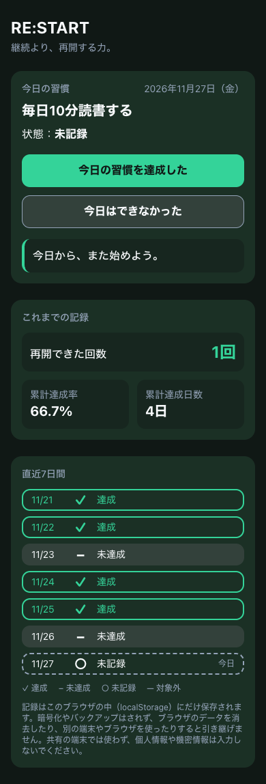
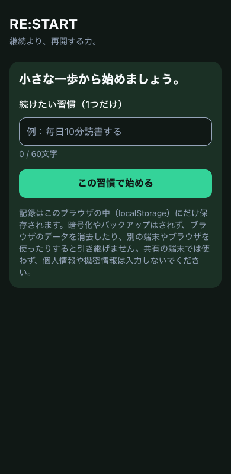
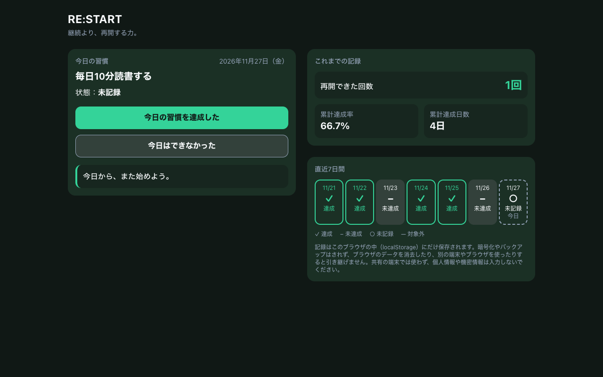

# RE:START

**継続より、再開する力。**

途切れた習慣を、もう一度始めるための記録アプリです。1つの習慣について、今日できたかどうかを1タップで記録し、「再開できた回数」と累計の達成を見える形にします。

**公開URL：https://restart-app-opal.vercel.app/**（登録不要。記録はお使いのブラウザの中だけに保存されます）



## 開発背景

習慣が一度途切れると、それまでの努力まで無駄になったように感じて、やめてしまう人がいます。多くの習慣アプリは「連続日数」を中心に表示するため、1日休むと記録がゼロに戻り、かえって再開しにくくなることがあります。

RE:START は連続日数ではなく、**途切れたあとに戻ってきた回数**と**累計の達成**を記録します。休んだ日があっても、それまでの達成は消えません。

> 心理的な効果は設計上の仮説であり、効果を保証するものではありません。

## 解決する課題

- 1日休むと「連続記録」が消え、それまでの努力がなかったことのように感じてしまう
- 完璧にできなかった日を、全体の失敗と捉えてしまう
- 生活リズムが不規則で、毎日続けること自体が難しい

## ターゲット

| 想定ユーザー | 状況 |
|---|---|
| 会社員（主な対象） | 疲れなどで読書や勉強が途切れ、そのままやめてしまいやすい |
| 学生 | 完璧主義で、未達成の日を全体の失敗と捉えやすい |
| シフト勤務の人 | 生活リズムが不規則で、毎日の実施が難しい |

年齢・属性は設計のための仮説です。

## 主要機能

- **習慣の登録**：1つだけ登録します（前後の空白を除いて1〜60文字。文字数は Unicode のコードポイント数で数えます）
- **今日の記録**：「今日の習慣を達成した」「今日はできなかった」を1タップで記録します。同じ日に押し直すと上書きされます
- **再開できた回数**：一度達成したあと、1日以上の空白（未達成・未記録）をはさんで再び達成した回数です。初回の達成は数えません
- **累計達成率・累計達成日数**：登録日から昨日までと、記録済みなら今日を対象にします。記録がまだない場合は「—」と表示します
- **直近7日間**：達成 ✓／未達成 −／未記録 ○／登録前 — を、記号と文字で表示します
- **状況に合わせたメッセージ**：たとえば再開した日は「再開できました！戻ってきたことも、あなたの実績です。」と表示します
- **端末内への保存と復元**：ブラウザを閉じても、同じブラウザで開けば記録が戻ります
- **日付の切り替わりへの対応**：開いたまま深夜0時を過ぎても、30秒以内か画面に戻った時点で今日の日付を更新します。日付が変わった直後の操作は記録せず、もう一度選ぶよう案内します
- **データを失わないための処理**：保存に失敗した場合は前の状態を保ちます。保存データが壊れていても、自動で消去しません

画面は1つだけです（URL は `/`）。初回登録と通常の画面は、同じページの中で切り替わります。

## 実画面

| スマートフォン（390px） | 初回登録 | PC（1280px） |
|---|---|---|
|  |  |  |

スクリーンショットは `npm run test:e2e` で、架空の習慣名と記録を使って撮影したものです。

## 技術構成

| 分類 | 使用技術（バージョン） |
|---|---|
| フレームワーク | Next.js 16.4.6（App Router）、React 19.3.0 |
| 言語 | TypeScript 5.9.3 |
| スタイル | Tailwind CSS 4.3.3 |
| 保存 | ブラウザの localStorage（キー `restart:v1`） |
| テスト | Vitest 5.1.2、ヘッドレス Chrome（DevTools Protocol を直接使用） |
| Lint | ESLint 9.39.5、eslint-config-next 16.4.6 |
| 開発環境 | Node.js 24.14.0、npm 11.9.0 |

正確な依存バージョンは `package-lock.json` に記録されています。

**設計の方針**

- 日付処理・集計・保存は `lib/` の関数にまとめ、画面の部品（`components/`）では計算や保存をしません
- 日付は端末のローカル暦日で扱い、日数の計算は時刻を含まない暦日の通し番号で行います（夏時間の影響を受けません）
- サーバーでは「読み込み中」だけを描画し、保存データはブラウザで読み込みます。読み込み前に初回登録フォームが一瞬表示されることはありません
- 外部API・データベース・認証・外部フォント・外部画像は使っていません

```text
app/          ページの土台（layout / page / globals.css）
components/   画面の部品（計算や保存はしない）
hooks/        画面の状態をまとめる useRestartApp
lib/          日付・集計・記録・保存・メッセージ（純粋関数中心）
types/        データの型
tests/        Vitest の自動テスト
e2e/          ブラウザ確認（npm run test:e2e）
docs/         要件の追補、テスト結果、スクリーンショット
```

## セットアップ

Node.js 24 と npm を使います。

```bash
npm ci
npm run dev        # http://localhost:3000 で開発サーバーを起動
```

本番ビルドで確認する場合：

```bash
npm run build
npm run start      # http://localhost:3000
```

環境変数や API キーは不要です。

## テスト

| コマンド | 内容 |
|---|---|
| `npm run typecheck` | 型チェック（`next typegen && tsc --noEmit`） |
| `npm run lint` | ESLint |
| `npm test` | Vitest の自動テスト（日付・集計・保存・状態の処理） |
| `npm run test:tz` | 東京・ニューヨーク・オークランドのタイムゾーンで Vitest を実行 |
| `npx vitest run tests/stats.test.ts -t "T09"` | 1件だけ実行する例（テスト名に T 番号が入っています） |
| `npm run test:e2e` | 本番ビルドを使ったブラウザ確認 |

`npm run test:e2e` について：

- macOS の Google Chrome を使います。別の場所にある場合は `CHROME=<Chrome本体のパス> npm run test:e2e` のように指定します
- アプリと Chrome は 127.0.0.1 だけで待ち受け、Chrome は毎回新しい一時プロファイルで起動します。終了時に、起動したプロセスだけを止めて一時プロファイルを削除します
- 結果・ログ・スクリーンショットは `e2e-results/<日時>/` に保存されます（Git の管理対象外）
- 日付の切り替わりはページ内のテスト用の時計で確認し、パソコンの時刻は変更しません

最新の結果と、未実施の項目は [docs/test-report.md](docs/test-report.md) にまとめています。

## 制限事項

- **記録はこのブラウザの中だけに保存されます。** 暗号化やバックアップはされません。ブラウザのデータを消去すると記録は失われ、別の端末やブラウザには引き継げません
- 共有の端末での利用や、個人情報・機密情報の入力はおすすめしません
- 習慣は1つだけです。習慣名の編集・削除、過去の日の記録・修正、通知、複数の習慣、アカウント、同期には対応していません
- 1つのタブで使う前提です。別のタブで変更されたことを保存の直前に検出した場合は、上書きせずに最新の内容を表示します（同時編集の完全な制御はしていません）
- 端末の日付が登録日より前になっている場合は、記録を止めて時刻の確認を案内します
- オフラインでの起動は保証しません
- 動作確認は、ヘッドレス Chrome での自動テストと、iPhone の Safari での実機確認（開発者本人による手動確認）で行いました。Android・Firefox・PC 版 Safari などは未確認です。読み上げソフト（VoiceOver など）での実機確認は未実施です。すべての環境での動作を保証するものではありません（詳しくは [docs/test-report.md](docs/test-report.md)）

## ドキュメント

- [requirements.md](requirements.md)：要件定義書（原本）
- [docs/requirements-addendum.md](docs/requirements-addendum.md)：実装計画のレビューで承認された追補
- [docs/test-report.md](docs/test-report.md)：テスト結果（T01〜T36、公開環境での確認を含む）
- [docs/backlog.md](docs/backlog.md)：今後の改善候補（未実装）
